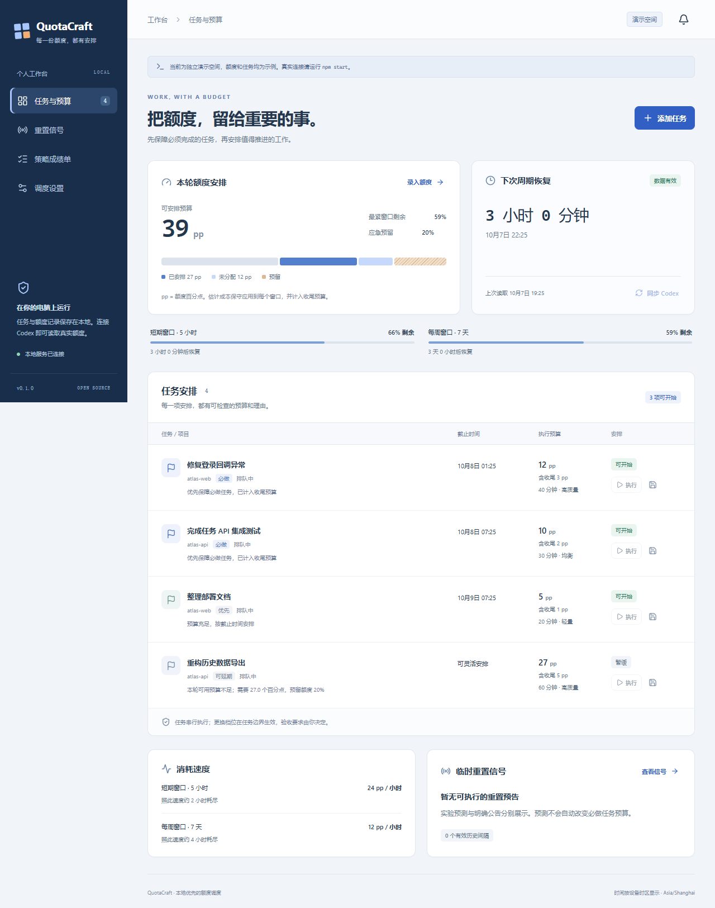

# QuotaCraft

**把额度留给重要的事。** 本地优先的 Codex 额度调度助手：按照任务重要性、截止时间、成本区间和收尾预算安排工作，在额度恢复后继续推进，并记录真正通过验收的成果。

[English](README.en.md) · [架构与接口](docs/ARCHITECTURE.md) · [预测方法](docs/FORECAST.md) · [安全与边界](SECURITY.md) · [v0.1.0](docs/RELEASE.md)



## 和普通额度监控有什么区别？

- **先保证交付**：必做任务优先，截止时间参与排序；每个任务单独预留测试、修复和收尾预算。
- **每项安排都有理由**：显示可开始、暂缓、截止风险、预算和模型档位；高质量任务不会因为额度低而偷偷降档。
- **真正的执行入口**：可显式启用串行 `codex exec` 队列。监测额度预留线、数据有效期和运行时间，保存摘要并暂停自己启动的进程树。
- **验收之后才计为完成**：进程成功退出进入待验收，由用户确认；保留截止时间和估计误差记录。
- **重置有证据层级**：正常周期恢复、Tibo 公开信号、赠送重置次数和本账号额度恢复分别记录。概率、预告和账号观测不混为一谈。
- **Web + CLI + MCP**：使用同一个本地 SQLite 数据库，无需 OpenAI API Key，不读取 `auth.json`，不安装系统后台任务。

## 快速开始

需要 **Node.js 22.13+**。真实额度需要已安装的 [Codex CLI](https://learn.chatgpt.com/docs/cli) 并通过 `codex login` 使用 ChatGPT 账号登录。

```bash
npm ci
npm run build
npm start
```

打开 **http://127.0.0.1:4318**。服务会在启动时和之后每两分钟通过官方 `codex app-server` 读取额度。登录失败时显示原因，保留现有记录，过期数据不会获得执行准入。

先体验独立的演示空间：

```bash
npm run start:demo
```

演示包含合成额度、任务和讨论信号，不连接账号、不调用模型；与真实数据分开保存。开发模式使用 `npm run dev` 或 `npm run demo`。

## 常用流程

1. 同步真实额度，或从官方用量界面手动录入；手动数据只用于规划。
2. 添加任务、项目、重要性、截止时间、预计分钟数和成本区间。成本单位是 **pp（额度百分点）**，不是 token。最高估计与收尾预留之和作为准入预算，保守应用于每个暴露窗口。
3. 设置应急预留（默认 20%）和三个质量档位的模型 ID，使用账号实际可用的模型。
4. 根据计划推进任务。需要暂停时记录改动、检查结果、剩余工作和安全的下一步。
5. 确认验收后记录完成；执行输出只是辅助证据，不自动认定任务通过。

### 显式启用自动执行

默认只规划，不启动模型。执行真实任务需要在启动时允许执行，并为任务填写存在的绝对工作目录和执行说明：

```bash
# macOS / Linux
QUOTACRAFT_ALLOW_EXEC=1 npm start
```

```powershell
# Windows PowerShell
$env:QUOTACRAFT_ALLOW_EXEC='1'
npm start
```

可以逐项点击“执行”，或在设置里启用“自动推进任务队列”。执行器一次只启动一个任务，采用 `workspace-write` 沙箱和非交互审批；对现有项目仍应使用 Git 管理改动。任务说明会附带验收要求和已有断点。模型不存在或启动失败时暂停，不会自动更换为另一模型。

服务每 15 秒检查管理中的任务，每两分钟刷新真实额度。触及预留线、读取过期或超过运行时间上限时，停止其进程树并保存最后可用的助手摘要。服务异常退出后，原任务恢复为已暂停，用户检查文件与残留进程后再恢复。

当前恢复采用**新 Codex 会话 + 持久化断点 + 原工作目录**，不假装能无损续接旧上下文。保存的 `sessionId` 用于诊断。不会自动兑换 banked reset、购买额外额度或发布任务产生的改动。

### 重置预测与提醒

- 本地模型使用导入的明确全体用户重置记录，提供 24h、72h、7d 实验估计；数据不足显示“历史样本不足”。见 [模型说明](docs/FORECAST.md)。
- 手动添加原帖和时间会明确标记为手动来源。
- 可选 `X_BEARER_TOKEN` 使用官方 X API 读取 `@thsottiaux` 的公开帖子；服务每 15 分钟检查一次，X API 可能计费。未配置时不调用。
- “社区预测”按钮读取 [Codex Reset Observatory](https://github.com/gussuri/codex-reset-observatory) 的公开只读 API；第三方概率单独展示，**不参与任务执行决策**。
- “临时重置机会预算”默认关闭。开启后，只有未来 24 小时内的明确全体重置预告，才能为可延期任务释放指定的少量预留。预测概率本身不会扩大预算。
- 通知包含预留线、正常恢复、意外账号恢复、公告、任务暂停和待验收。在设置中启用浏览器通知并保持页面打开；页面关闭时，消息仍保存在本地，但不会发送系统推送。

## CLI

```bash
node dist/cli.js status --refresh
node dist/cli.js plan
node dist/cli.js add examples/task.json
node dist/cli.js import-signals examples/signals.json
```

`examples/signals.json` 为空数组，避免把编造历史带入真实模型。信号格式见 [架构文档](docs/ARCHITECTURE.md)。

## MCP 接入

以 [Codex MCP 配置](https://learn.chatgpt.com/docs/mcp) 为例，将以下内容加入自己的 `config.toml`，替换为实际绝对路径：

```toml
[mcp_servers.quotacraft]
command = "node"
args = ["F:/Workspace/idea/quotacraft/dist/cli.js", "mcp"]
```

可选环境变量应与 Web 控制台使用一致的数据目录：

```toml
[mcp_servers.quotacraft.env]
QUOTACRAFT_DATA_DIR = "F:/Private/quotacraft-data"
```

提供 7 个工具：`quota_status`、`task_create`、`task_preflight`、`task_checkpoint`、`task_resume`、`task_complete`、`schedule_plan`。推荐流程：创建任务 → 每个昂贵阶段前 preflight → 根据 `ready/wait` 决定执行 → 保存断点或记录验收。

MCP 是宿主遵守的准入协议，不能强制限制宿主已经发出的模型请求，也不能停止其他设备消耗。MCP 不自行启动任务执行器或后台轮询。

## 环境配置

环境变量由启动环境提供；项目不会自动加载 `.env`。`.env.example` 仅作为配置说明。

| 变量                    | 默认值          | 作用                                       |
| ----------------------- | --------------- | ------------------------------------------ |
| `QUOTACRAFT_PORT`       | `4318`          | 本机控制台端口                             |
| `QUOTACRAFT_DATA_DIR`   | `~/.quotacraft` | 私有数据目录                               |
| `QUOTACRAFT_ALLOW_EXEC` | `0`             | 是否允许启动 Codex 任务                    |
| `QUOTACRAFT_CODEX_BIN`  | 自动发现        | Codex 可执行文件或 `bin/codex.js` 绝对路径 |
| `X_BEARER_TOKEN`        | 未配置          | 可选的官方 X API 访问令牌                  |

Windows 自动发现 npm 全局安装的 `@openai/codex/bin/codex.js`；自定义安装可以显式指定路径。不执行 `.cmd/.bat/.ps1` 包装器，以避免 shell 参数注入。

## 开发与验证

```bash
npm run check       # 类型、核心测试、生产构建
npm run test:e2e    # 桌面和 375px 视口浏览器验收
```

本机 E2E 默认使用 Microsoft Edge。CI 使用 Chromium，并通过 Playwright 安装浏览器；测试与运行示例使用合成数据，不消耗模型额度。

测试覆盖多个额度窗口、截止排序、收尾预算、过期数据、账户与周期切换、事件去重、预测边界、串行执行、进程暂停、验收流程、真实 stdio MCP 握手、跨站请求拒绝和表单键盘焦点。

## 当前边界

- 这是可运行的 **v0.1.0 MVP**，目标为 Codex / ChatGPT Work 的可观测订阅额度，不宣称覆盖 ChatGPT 网页上的所有模型限额。
- 成本区间目前由用户填写；短时间、同账号、同周期的连续读数用于估算消耗速度，尚未自动学习单任务成本模型。
- 模型价格不等于订阅额度权重，切换低价模型不保证按比例节省订阅额度。每个窗口的真实消耗仍以官方读数为准。
- 执行中观测的额度变化可能包括其他设备消耗，不是精确单任务归因。
- 预测尚未用足够真实事件校准。没有公开的重置排期，也没有额度不耗尽保证。
- 当前只提供本机浏览器提醒。移动推送、多账号、自动重置兑换、跨模型池调度和自然语言任务解析尚未实现。

## 参考与来源

实现为独立编写，没有复制调研仓库的源码。机制参考 [官方 Codex App Server](https://learn.chatgpt.com/docs/app-server)、[MCP TypeScript SDK](https://github.com/modelcontextprotocol/typescript-sdk)；竞品调研包含 [Tibo Reset Radar](https://github.com/RZX00/tibo-reset-radar)、[Usage Guard](https://github.com/agent-layer-mcp/usage-guard)、[Codex Quota Guard](https://github.com/valentine-89/codex-quota-guard-mcp)、[Codex Fuel Gauge](https://github.com/zcor/codex-fuel-gauge) 和 [Tokenmax](https://github.com/danieldrinhausen/Tokenmax)。

MIT License。独立社区项目，与 OpenAI 无隶属关系。
